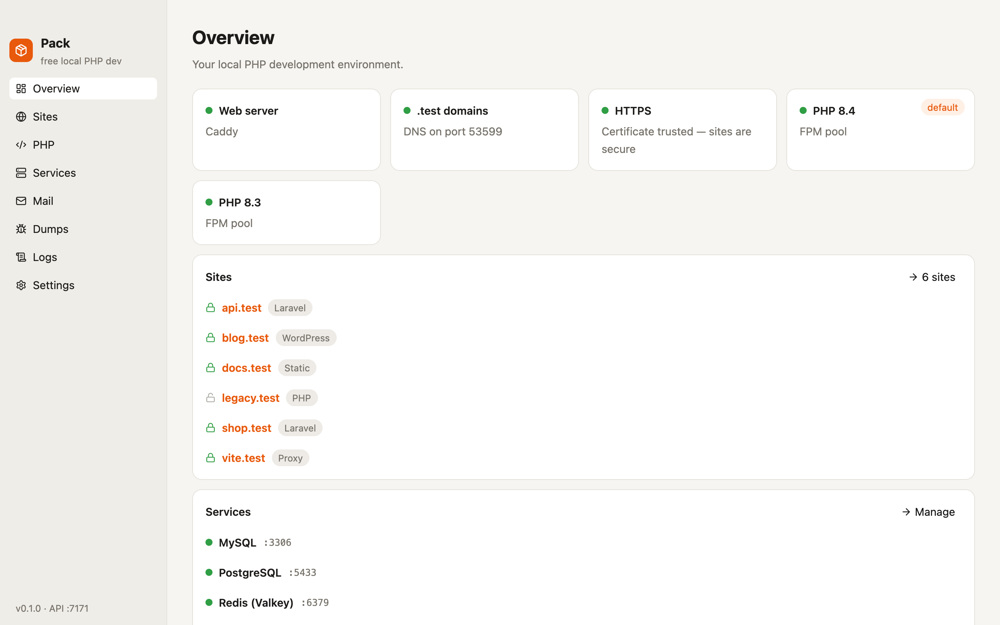
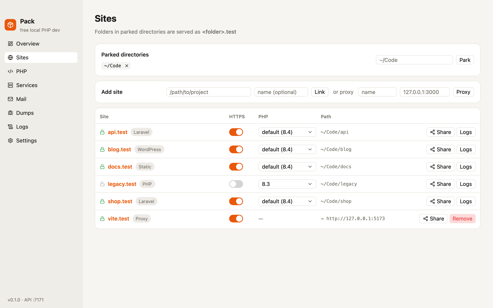
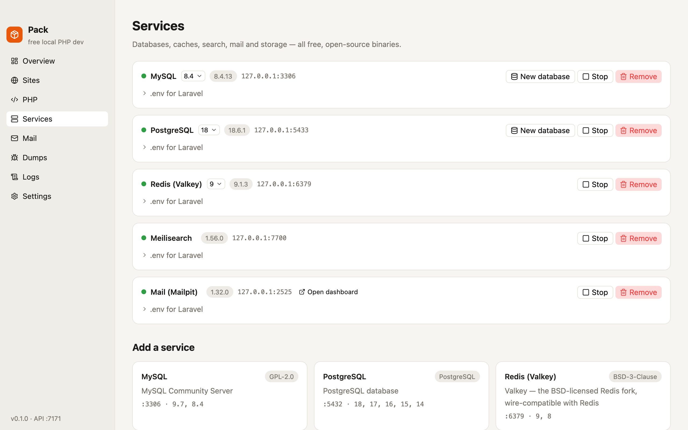
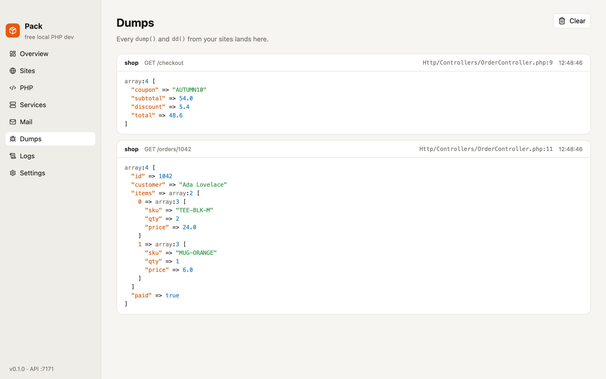
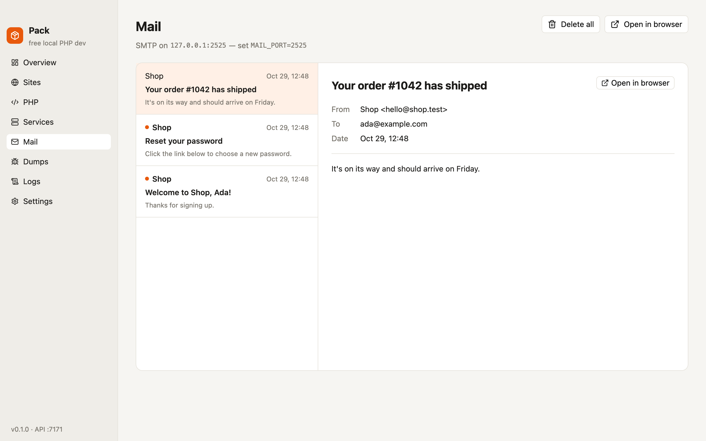

# Pack

A free, open-source local PHP development environment for macOS, Windows and Linux.

Put a project in a folder and it's live at `https://<folder>.test`: HTTPS, PHP, databases and mail included, nothing to configure.

<picture>
  <source media="(prefers-color-scheme: dark)" srcset="docs/screenshots/overview-dark.png">
  
</picture>

<table>
  <tr>
    <td><picture><source media="(prefers-color-scheme: dark)" srcset="docs/screenshots/sites-dark.png"></picture></td>
    <td><picture><source media="(prefers-color-scheme: dark)" srcset="docs/screenshots/services-dark.png"></picture></td>
  </tr>
  <tr>
    <td><picture><source media="(prefers-color-scheme: dark)" srcset="docs/screenshots/dumps-dark.png"></picture></td>
    <td><picture><source media="(prefers-color-scheme: dark)" srcset="docs/screenshots/mail-dark.png"></picture></td>
  </tr>
</table>

- **Sites:** every folder becomes `https://<name>.test` with a trusted certificate. You can turn HTTPS off per site.
- **PHP:** versions 8.2 to 8.5 side by side, picked per site. Composer and the Laravel installer are included.
- **Services:** MySQL, PostgreSQL, Redis, Meilisearch, Typesense (search for Laravel Scout), MongoDB, S3 storage, Reverb. Each starts with one click, and switching versions keeps your data.
- **Mail and dumps:** a local inbox catches every email. `dump()` and `dd()` output shows up in the app.
- **Sharing:** you can share a site through a public link.
- **Updates:** PHP and every service update from the app or with `pack update`.

## Install

Download the app for your system from [Releases](https://github.com/KumaVolt/pack/releases):

| System  | File |
|---------|------|
| macOS   | `.dmg` (Apple Silicon or Intel) |
| Windows | `.msi` or `-setup.exe` |
| Linux   | `.deb` or `.AppImage` |

Open Pack and click **Set up**. Pack downloads what it needs and asks for your password once, so it can route `.test` domains to your machine and trust its HTTPS certificate.

> The app isn't code-signed yet. On macOS, right-click Pack.app → **Open** the first time. On Windows, choose **More info → Run anyway**.

## Command line

The app adds `pack`, `php`, `composer` and `laravel` to your terminal.

```sh
pack park ~/Code        # every folder in ~/Code becomes <folder>.test
pack link               # serve the current folder
pack open               # open it in the browser
pack use 8.3            # default PHP version
pack isolate 8.2        # PHP version for this site only
pack service add mysql  # add a service (postgres, redis, meilisearch, ...)
pack db shop            # create a database
pack share              # public link to this site
pack update             # update PHP and services
pack status
```

Run `pack --help` for everything.

## How it works

One small program (`pack`) runs in the background. The desktop app is a native [GPUI](https://www.gpui.rs) window (built with [GPUI Component](https://github.com/longbridge/gpui-component)) and a menu bar / tray icon that talk to it. The daemon serves sites through [Caddy](https://caddyserver.com), runs a PHP-FPM pool per PHP version (php-cgi on Windows), and answers DNS for `.test`. It also keeps your services running.

Everything Pack installs is a prebuilt, checksummed package from this repository's releases, listed in a [manifest](https://github.com/KumaVolt/pack/releases/tag/manifest). A daily workflow rebuilds them when new versions come out. All data lives in one folder, so removing that folder removes everything:

| System  | Data folder |
|---------|-------------|
| macOS   | `~/Library/Application Support/Pack` |
| Windows | `%LOCALAPPDATA%\Pack` |
| Linux   | `~/.local/share/pack` |

## Development

```sh
cargo run -p pack -- daemon       # run the daemon in the foreground
cargo run -p pack-app             # run the desktop app (starts the daemon if needed)
scripts/build-app.sh              # build the app and its installers for this machine (needs cargo-packager)
scripts/smoke.sh target/release/pack   # end-to-end test in a throwaway home
cargo build --release -p pack-app --features screenshots
scripts/screenshots.sh target/release/pack target/release/pack-app   # retake the README screenshots
```

On Linux, `sudo scripts/linux-deps.sh` installs the libraries the app needs to build.

The screenshots are retaken by `.github/workflows/screenshots.yml` whenever the app or daemon changes. `pack-app --screenshots <dir>` renders each page offscreen, and only once its data is there: the Services page waits until every service is running.

The packages are built by `scripts/packages.py` (see `.github/workflows/packages.yml`).

## License

MIT
